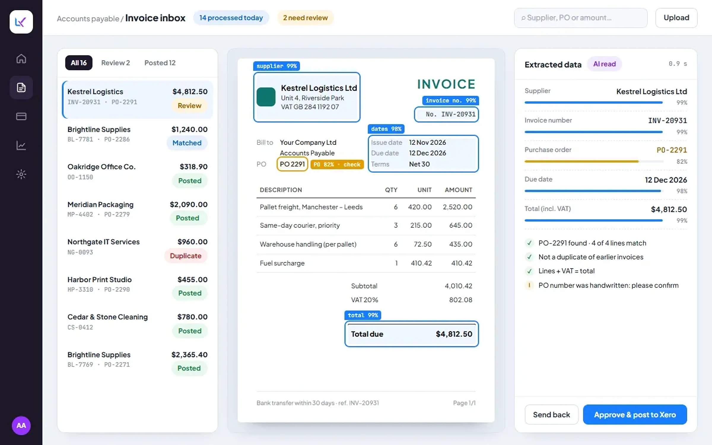

<!-- styled:v2 -->

**> **Solution blueprint.** A reference architecture Lexvaxa designed for this problem, not a delivered client project.**

  <a href="#overview">Overview</a> ·
  <a href="#key-features">Key features</a> ·
  <a href="#tech-stack">Tech stack</a>

---

**Supplier invoices read, checked against purchase orders and posted to accounting, with people approving only the exceptions.**

      

## Overview

A solution blueprint for finance teams that key invoices in by hand. Invoices arriving by email or upload are read by a document model, matched to purchase orders and suppliers, checked for duplicates and totals, and posted to the accounting system. Anything unusual waits in a review queue with the reason shown.

## The challenge

Manual data entry is slow, error-prone and leaves no clear record of who checked what.

## The solution

Extraction with confidence scores, rule-based matching and an approval queue, so routine invoices post themselves and people decide only the exceptions.

## Key features

- Field extraction with confidence scores
- Purchase order and duplicate matching
- Exception queue and posting with an audit trail

## Tech stack

    

## Privacy

This blueprint uses illustrative data only.

## Links

- Case study on Lexvaxa: https://lexvaxa.com/work/invoice-processing-automation

---

**Built by [Ch Muhammad Samiullah](https://github.com/samiullah156-creator)** · AI Automation Engineer and Full-Stack Developer at [Lexvaxa](https://lexvaxa.com)

⭐ Star this repo if you found it useful

